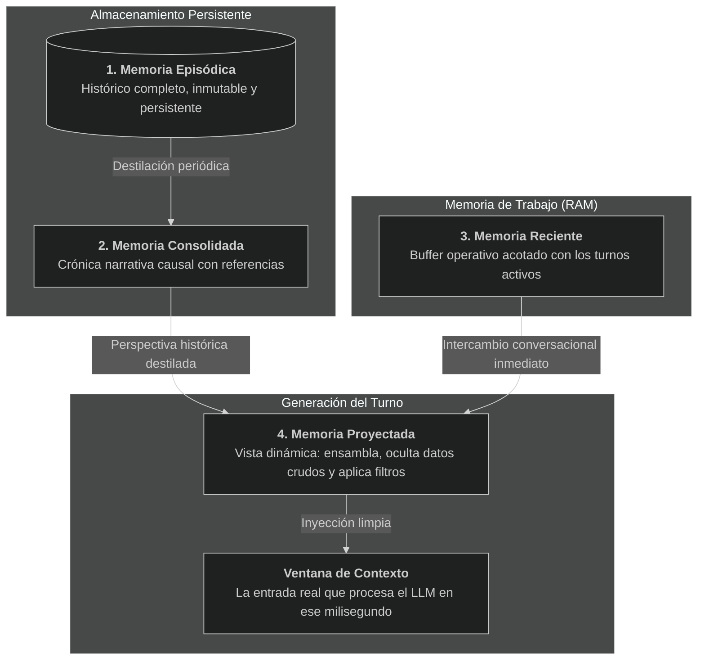
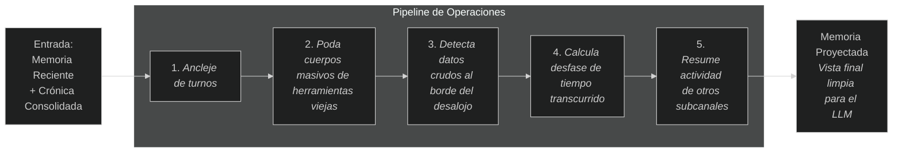
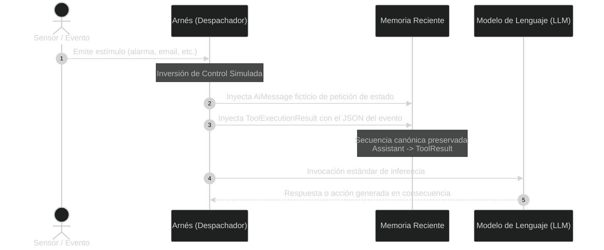
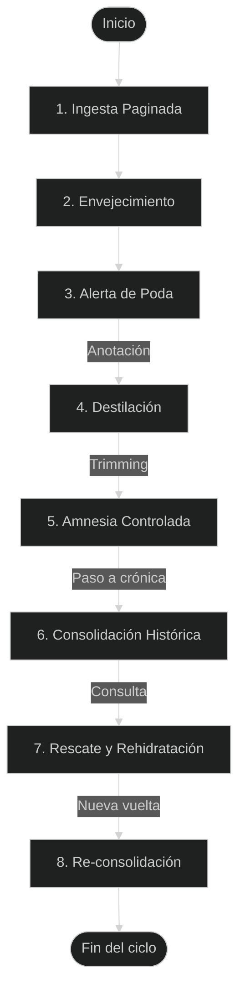

# Arquitectura para agentes de IA de largo recorrido

Voy a tratar de exponer una propuesta de arquitectura para agentes de IA de largo recorrido. la exposición va a constar de las siguientes partes:

* Una primera introducción con:
  * El paradigma del ejecutor de corto recorrido.
  * Atención degradada y coste de transferencia
  * El falso dilema de la capacidad de gobierno vs. agilidad operativa

Esta introducción irá seguida de una exposición de conceptos que van a aparecer a lo largo de la exposición, y de los conceptos clave de la arquitectura:

* Conceptos y glosario operativo
* Ideas base de la arquitectura propuesta
* La gestión de memoria estratificada
* La gestión continua de eventos
* Ingesta de datos integrada con la gestión de memoria

Después repasaré los mecanismos necesarios para orquestar la arquitectura para acabar repasando:
* La Capa de Ejecución del agente
* El sistema como un todo
* Principios que esta arquitectura defiende

## I. El paradigma del ejecutor de corto recorrido.

El desarrollo reciente de agentes de inteligencia artificial aplicados a la ingeniería de software ha convergido en torno a un patrón dominante: el ejecutor de tareas de corto recorrido. Herramientas diseñadas para operar en sesiones breves resuelven con solvencia tareas acotadas, la refactorización de una función, la localización de un fallo en una traza de error o la aplicación de modificaciones en un puñado de archivos bajo supervisión inmediata. Su mecánica se basa en bucles de interacción síncronos (*eval-print-loop* o llamadas iterativas a herramientas) donde un modelo de lenguaje inspecciona el entorno, genera una acción, evalúa el resultado inmediato y entrega el control al usuario en cuestión de minutos.

En este terreno de intervención inmediata, la industria ha alcanzado una notable eficacia. La latencia de respuesta se ha reducido, las herramientas de manipulación del sistema de archivos son rápidas y los entornos de ejecución están razonablemente integrados en los editores de código. El problema surge cuando se pretende extrapolar esta misma arquitectura a la continuidad a lo largo de semanas o meses en un proyecto tras otro. En ese punto, el paradigma resulta insuficiente porque carece de una teoría de la persistencia del conocimiento.

Para esquivar este límite se suele recurrir a dos atajos técnicos. Confiar ciegamente en ventanas de contexto gigantescas, inyectando historiales enteros de conversación bajo la premisa de que una capacidad nominal de cientos de miles de tokens. O el uso de sistemas de generación aumentada por recuperación (RAG) pasivos, donde una base de datos vectorial inyecta fragmentos descontextualizados en el prompt antes de cada turno. Ambos enfoques eluden el problema de fondo. Ninguno gestiona activamente la evolución, síntesis y depuración del conocimiento acumulado, limitándose a almacenar texto o delegar en la fuerza bruta del contexto.

## II. Atención degradada y coste de transferencia

La dependencia de ventanas de contexto sobredimensionadas entra en contradicción con la naturaleza física del mecanismo de atención en las arquitecturas Transformer. La capacidad nominal de una ventana de contexto indica el volumen máximo de tokens que el modelo puede procesar formalmente sin desbordar su espacio posicional, pero no describe la calidad del cálculo sobre esa secuencia. La investigación empírica ha demostrado de forma recurrente el fenómeno de degradación atencional conocido como *Lost in the Middle*. La precisión en la recuperación de información y el rigor en el razonamiento lógico caen drásticamente cuando los datos críticos se encuentran en el segmento intermedio de una secuencia larga, en lugar de situarse al principio o al final. En la práctica, someter a un modelo a secuencias masivas no genera un agente mejor informado, sino un razonador disperso cuya capacidad de atención decae sensiblemente mucho antes de alcanzar el límite teórico de la ventana.

A esta degradación interna se suma una fricción operativa constante: el coste de transferencia de contexto entre tareas (*onboarding overhead*). En el trabajo real de ingeniería de software, un desarrollador no mantiene una conversación ininterrumpida de meses. Ejecuta decenas de sesiones independientes distribuidas a lo largo de días o semanas. Con la arquitectura estándar, cada nueva sesión arranca desde una amnesia absoluta. El desarrollador se ve obligado a volver a explicar los antecedentes, justificar decisiones arquitectónicas tomadas con anterioridad, recordar convenciones de nombrado que no figuran explícitamente en el código o acotar qué áreas del repositorio no deben modificarse. La ausencia de un estado persistente convierte cada arranque en un proceso redundante y propenso a inconsistencias.

Este escenario se agrava por una confusión conceptual recurrente: equiparar datos brutos con conocimiento. Cuando un agente examina un archivo de registro de diez mil líneas o analiza el árbol completo de dependencias de un proyecto, vuelca con frecuencia todo ese volumen en el historial de la conversación. Ese volcado no aporta valor analítico al modelo: satura la ventana de atención con ruido sintáctico. El modelo no necesita retener de manera perpetua cada línea de un archivo para trabajar con él. Necesita retener la conclusión técnica derivada. por ejemplo, qué módulo falló, bajo qué condiciones y con qué impacto sobre el diseño. El dato bruto es volátil y prescindible; el conocimiento derivado es compacto y debe preservarse. Confundir ambos términos satura el contexto con datos sin valor analítico.

## III. El falso dilema de la capacidad de gobierno vs. agilidad operativa

Frente a las limitaciones de memoria de los modelos actuales, se ha consolidado en el sector la creencia de que existe un compromiso inevitable entre rigor analítico y agilidad operativa. Según esta postura, un agente dotado de estructuras para gestionar su persistencia y regular su estado a largo plazo estaría abocado a ser un sistema lento, burocrático y de corte consultivo, incapaz de competir en velocidad con los ejecutores de corto recorrido modernos. Por el contrario, se asume que un agente rápido en la edición de código debe ser necesariamente amnésico y operar sin preocuparse por la continuidad temporal del proyecto.

Este dilema es artificial. La capacidad de un sistema para retener conocimiento acumulado no compite con su capacidad para manipular el entorno mediante herramientas; son dimensiones ortogonales. Un agente no pierde facultades de edición por el hecho de saber por qué se tomó una decisión arquitectónica tres semanas atrás. Al contrario, es capaz de editar con mayor precisión precisamente porque conoce las restricciones del proyecto y no precisa volver a explorarlas desde cero.

La agilidad operativa no exige amnesia. Que un agente disponga de un sistema riguroso de control de contexto no le impide ejecutar un parche en el sistema de archivos, realizar una llamada de terminal, invocar un servidor a través del protocolo MCP o procesar un cálculo masivo en un entorno seguro. La ejecución técnica no es el enemigo de la persistencia; es la consecuencia directa de contar con una base de conocimiento depurada sobre la que decidir la acción correcta.

## IV. Conceptos y glosario operativo

Para evitar ambigüedades terminológicas y asentar el vocabulario técnico que articulará la descripción de la arquitectura, voy a establecer las siguientes definiciones operativas. Estas no pretende ir más allá de eso, articular una nomenclatura común a usar a lo largo de este texto:

*   **Modelo de lenguaje (LLM):** Red neuronal probabilística con pesos congelados tras su entrenamiento. Es un procesador estadístico sin estado interno persistente. No aprende, no almacena información de forma duradera ni acumula experiencia entre invocaciones independientes. Opera como una unidad de cálculo estática.

*   **Arnés:** La infraestructura de software externa que envuelve al modelo de lenguaje. Gobierna su ciclo de vida, captura los estímulos de entrada, construye el contexto que se presenta al modelo, intercepta y ejecuta las llamadas a herramientas y persiste el estado localmente si fuese necesario.

*   **Agente:** La entidad funcional resultante de la interacción entre el modelo de lenguaje, el arnés que lo custodia y el catálogo de herramientas y sensores a los que tiene acceso.

*   **Agente de largo recorrido:** Es aquel que se comporta como una entidad biográfica, que desarrolla una identidad evolutiva y sostenida en el tiempo. Su continuidad no solo captura información, sino que mantiene la intención y el contexto de su pasado, convirtiéndolo en un colaborador capaz de evolucionar junto al usuario.

*   **Agente de corto recorrido:** Es aquel que se comporta como un operador de presente extendido diseñado para la agilidad y el pragmatismo transitorio. Su identidad es puramente funcional. Vive sin historia profunda. Es eficaz resolviendo el presente basándose en el estado actual de las cosas, pero carece de la biografía necesaria para inferir la intención que las generó.

*   **Contexto:** La secuencia exacta y finita de tokens cargada físicamente en el espacio de entrada del modelo de lenguaje en un instante de inferencia concreto. Constituye la única información de la que el modelo es consciente para generar una respuesta.

*   **Ventana de contexto:** El límite numérico máximo de tokens impuesto por la arquitectura física del modelo de lenguaje, por encima del cual la secuencia es truncada o rechazada.

*   **Ventana deslizante:** Técnica de procesamiento iterativo que evalúa un subconjunto de datos de tamaño fijo, desplazándose a lo largo de un conjunto mayor (ya sea historial de chat o líneas de un archivo), permitiendo analizar el contenido superponiendo los márgenes para no perder contexto entre bloques.

*   **Conocimiento:** Abstracción destilada e indexable derivada del análisis de datos o de instrucciones directas del usuario. Ocupa un volumen mínimo de tokens y tiene vocación de permanencia en el sistema.

*   **Memoria:** El conjunto de estructuras y procesos implementados en el arnés para almacenar, indexar, proyectar y recuperar conocimiento a lo largo del tiempo, con independencia de los límites físicos de la ventana de contexto.

*   **Herramienta de ingesta de datos:** Herramienta cuya función es incorporar al sistema información procedente del exterior del mismo: el sistema de archivos, la terminal, la red u otras fuentes análogas. Se distingue de las herramientas de recuperación, que operan sobre información ya presente en la memoria y de las de edición, que modifican el estado del entorno. Ejemplos: lectura de ficheros, búsqueda literal o semántica en disco, ejecución de comandos en la shell, consulta de páginas web.

## V. Ideas base de la arquitectura propuesta

Antes de examinar los algoritmos y diseño concreto de los mecanismos que propongo, es necesario plantear las tres ideas sobre las que se articula este diseño. 
Estas tres ideas no son componentes aislados, librerías desacopladas ni módulos que puedan añadirse a posteriori sobre un agente existente. No son un plugin de memoria que se enchufa a un ejecutor de corto recorrido para darle persistencia. Constituyen la infraestructura misma sobre la que se construye el agente. Si alguna de estas falla, la coherencia del agente a largo plazo no suele degradarse ligeramente, suele romperse. 
Las tres ideas son:

* Una gestión de memoria estratificada (episódica, consolidada, reciente, proyectada)
* Una gestión continua de eventos
* Una ingesta de datos integrada con la gestión de memoria

Alrededor de estas tres ideas se articula y articulan la gestión del conocimiento del agente.

### 1. La gestión de memoria estratificada

La memoria del agente no puede sustentarse sobre un registro plano de mensajes que crece indefinidamente ni sobre una base de datos documental que vuelca fragmentos de texto en el contexto. El conocimiento se estructurará en estratos delimitados por su grado de abstracción, su inmutabilidad así como su distancia temporal respecto al momento actual de razonamiento. Ningún estrato intenta sustituir a los demás. Cada estrato de la memoria cumple una función específica dentro del sistema:

*   **Memoria episódica:** Constituye el registro histórico. Es inmutable y persiste todo evento ocurrido desde la inicialización del agente. Cada intervención del usuario, cada razonamiento del modelo, cada llamada a herramienta y cada resultado queda asentado con un identificador unívoco y una marca temporal. Los resultados de las herramientas de ingesta de datos se asientan truncados cuando su volumen supera un umbral. Conservan metadatos y referencias, pero no el cuerpo crudo completo. La entrada queda marcada como truncada, de modo que cualquier recuperación posterior del turno sea consciente de que el contenido íntegro no está disponible en ese estrato.  
    Esta memoria es el nivel más voluminoso. Resulta inviable cargarla directamente en el contexto debido a su tamaño, pero permanece accesible como almacén de referencia para recuperaciones posteriores.

*   **Memoria consolidada:** Actúa como puente cognitivo entre el volumen masivo de la memoria episódica y los límites físicos del contexto. Se genera de manera periódica y adopta la forma de una crónica narrativa continua junto con un resumen operativo. No retiene el detalle de cada turno, sino la intencionalidad de las decisiones, los giros metodológicos del proyecto y la evolución de los acuerdos, integrando referencias hacia los eventos episódicos originales.

*   **Memoria reciente:** Es el buffer operativo de trabajo mantenido en memoria volátil por el arnés donde transcurre la conversación inmediata y la interacción con herramientas en el presente. Su tamaño no está restringido por la memoria física del equipo anfitrión, sino por una directiva estricta de economía atencional: se mantiene acotada en un volumen de turnos controlado para garantizar que la inferencia del modelo se ejecute siempre en su zona de máxima fidelidad y atención. Se encarga de mantener la relación entre los turnos del contexto y los eventos de la memoria episódica.

*   **Memoria proyectada:** Representa la vista materializada y transitoria que el arnés construye para el modelo de lenguaje en el momento previo a su invocación. No persiste en disco con esa forma ni es idéntica a la memoria reciente. Es el resultado de aplicar una serie de filtros y operaciones sobre la memoria reciente. Oculta cuerpos de herramientas ya procesados, inserta señales temporales y añade advertencias operativas. Se disipa inmediatamente después de que el modelo emite su respuesta. Gestiona notificaciones *efímeras* para el LLM. Estas notificaciones *efímeras* no se propagan por todo el historial. Viven en el turno más reciente del contexto proyectado únicamente, y desaparecen cuando ya han cumplido su misión. Es el propio arnés quien se encarga de gestionar cuando deben aparecer y cuando desaparecen estas notificaciones.

<!-- https://mermaid.live/ -->




### 2. La gestión continua de eventos

El agente no responde al diseño clásico de una aplicación de consola que bloquea el hilo de ejecución esperando a que el usuario introduzca una línea de texto. El sistema se concibe como una arquitectura orientada a eventos donde rige el principio de que **todo estímulo es un evento**. La entrada de texto del usuario es un evento más dentro de una cola gestionada por el bucle de razonamiento, un despachador continuo que opera en segundo plano.

Esta perspectiva exige categorizar los eventos según su naturaleza de señal antes de entregarlos al bucle de razonamiento. No todos los eventos admiten el mismo tratamiento:
*   Los eventos **discretos** representan hitos atómicos que exigen atención individualizada (por ejemplo, una alarma temporal que vence o una confirmación crítica).
*   Los eventos **fusionables** forman parte de un flujo continuo; si el modelo se encuentra ocupado procesando un turno complejo y el usuario envía tres mensajes adicionales, estos deben concatenarse de forma estructurada con marcas temporales relativas en lugar de saturar al despachador con tres ejecuciones fragmentadas.
*   Los eventos **agregables** priorizan la frecuencia sobre el texto; ante una ráfaga de eventos repetitivos, el sistema retiene un contador y un intervalo de tiempo.
*   Las eventos de **estado** son volátiles y sustitutivas, donde únicamente el último valor registrado tiene vigencia analítica. Por ejemplo, un evento de que tienes correos nuevos en la bandeja de entrada.

Clasificar los estímulos según estas naturalezas previene que la concurrencia del entorno desborde la cola de trabajo o sature la atención del modelo con señales redundantes.

### 3. Ingesta de datos integrada con la gestión de memoria

Las herramientas de ingesta de datos no pueden diseñarse como utilidades de E/S autónomas e indiferentes a la gestión de la memoria. En un agente de largo recorrido, toda entrada de datos debe concebirse desde su diseño para cooperar con las políticas de memoria y retención del arnés.

Si una herramienta devuelve de golpe una salida de cincuenta mil líneas, ninguna estrategia de atención posterior podrá mitigar el impacto sin pérdida de control. Por tanto, las herramientas de ingesta deben incorporar restricciones de volumen desde origen: paginación obligatoria, emisión de instrucciones de navegación paso a paso 
o mensajes a utilizar cuando sea necesario emitir notificaciones efímeras al LLM. La herramienta de ingesta lee y se encarga  de dosificar el ritmo con el que los datos entran a la memoria en todos sus estratos para que el agente disponga del espacio necesario para destilarlos antes de que abandonen su campo de atención.

## VI. Mecanismos para orquestar las ideas base

La viabilidad de esta arquitectura descansa en el diseño de mecanismos que enlazan los conceptos teóricos con la ejecución física del software. A continuación se desglosan los principales mecanismos necesarios para hacer posible la interacción entre las ideas principales y la propia arquitectura en sí misma. Los agruparemos en función de a qué idea base están más ligados.

* Mecanismos de Memoria
  * El pipeline de proyección de contexto
  * Compresión narrativa y espiral de contexto
  * El ciclo de rehidratación
  * Trazabilidad determinista y validación de citas
  * Directivas operativas en el prompt del sistema
  
*  Mecanismos de Eventos
  * Engaño protocolario (Inversión de control)
  * Aislamiento multi-terminal y subcanales
  
* Mecanismos de Ingesta y Atención
  * Paginación como primitiva de sistema
  * Amnesia controlada de datos crudos (Trimming)
  * Gestión activa del presupuesto (Destilación forzada)
  * Válvulas de escape y aislamiento de ruido

### 1. Mecanismos de memoria

#### El pipeline de proyección de contexto

La memoria proyectada no se obtiene mediante una concatenación trivial de listas de mensajes. Se genera mediante un pipeline registrable de operadores ejecutados secuencialmente según una jerarquía estricta de prioridades. Dentro de la memoria proyectada, y para que las operaciones trabajen coherentemente se establecen tres zonas:
* La zona más reciente. Es una zona segura  en la que los mensajes permanecen inalterados. 
* La zona intermedia. En esta zona los mensajes permanecen inalterados, pero se le puede notificar al LLM que pueden ser recortados más adelante.
* La zona de mas antigua. Al entrar en esta zona los mensajes pueden ser recortados y modificados, pero una vez dentro estos permanecerán inalterados mientras no se realice una consolidación.

Las operaciones, operan teniendo en cuenta estas zonas. Las básicas son:
1.  *Operaciones de anclaje:* Localizan turnos y directivas de comportamiento fijadas (como habilidades procedimentales activas o mapas de proyecto) y, si la consolidación los ha expulsado de la memoria reciente, los reinyecta al inicio de la proyección, justo detrás del prompt del sistema.

*  *Operaciones de poda:* Sustituyen el cuerpo textual de ejecuciones de herramientas voluminosas por marcas compactas de metadatos cuando los turnos entran en la zona mas antigua.

*  *Operaciones de advertencia:* Evalúan si existen datos crudos próximos al desalojo que no hayan sido analizados por el modelo, inyectando un recordatorio efímero de destilación.

*  *Operaciones de percepción temporal:* Calculan el tiempo transcurrido desde la última interacción y, si este supera un umbral, inyectan una notificación efímera para reajustar la percepción cronológica del agente.

*  *Operaciones de consciencia periférica:* Añaden una notificación efímera con un resumen compacto de la actividad reciente en otros terminales paralelos del sistema.

*  *Operaciones de aviso de estrechamiento:* Detectan turnos de ingesta de datos que pueden ser susceptibles de otras formas de ingesta más óptimas e inyecta notificaciones avisando de ello al modelo. Para cada recurso cuyo volumen o conteos de nivel superan unos umbrales configurados, inyectan la notificación efímera que informa del tamaño, de los niveles detectados y de la sintaxis de las herramientas de estrechamiento disponibles (búsqueda por patrón, búsqueda difusa, recorte por cola). La operación no interpreta el contenido ni prescribe estrategia: se limita a hacer explícita una opción que el modelo puede o no seguir. Cada aviso se emite una sola vez por turno, en la proyección inmediatamente posterior a su llegada, y desaparece sin dejar rastro. 





#### Compresión narrativa y espiral de contexto

La consolidación de la historia episódica se aleja frontalmente del esquema tradicional de listas de viñetas o tablas de hechos aislados. Los modelos de lenguaje están optimizados para el procesamiento de prosa continua, donde las relaciones de causalidad, la intención y el matiz de las decisiones se expresan de manera orgánica. Por ello, la memoria consolidada se estructura siempre en dos partes: una sección factual ejecutiva y una crónica cronológica densa.

Esta crónica posee una textura intelectual y narrativa (capturando, por ejemplo, "la profunda reflexión tras un fallo de diseño" o "un punto de inflexión crítico en la arquitectura"). El mecanismo impone este nivel de detalle mediante directivas drásticas en su prompt: *"Si entregas una lista de puntos: HAS FALLADO. Si eres conciso: HAS FALLADO. Si narras la historia como un cronista detallado: HAS TENIDO ÉXITO"*. Esta cualidad narrativa trata de minimizar la pérdida del contexto cognitivo que origina cualquier decisión de software.

Este enfoque implementa una propiedad emergente clave: la **espiral de contexto**. Cuando se genera una nueva consolidación a partir del relato previo y los eventos recientes, el sistema no añade un bloque al final de forma incremental. Reevalúa los núcleos narrativos del pasado a la luz de los acontecimientos presentes. Los temas que llevan tiempo inactivos sufren una síntesis progresiva, reduciendo su extensión hasta convertirse en menciones mínimas sin perder sus referencias de origen, mientras que los temas que se retoman expanden su resolución narrativa. El resultado es un sistema de **autocompresión** que produce un gradiente natural de detalle.
La pérdida de detalle que puede conllevar esta autocompresion no es un fallo residual, sino parte del diseño. La integridad no reside en que la superficie narrativa lo conserve todo, sino en que sepa qué ha comprimido y cómo recuperarlo.

Sin embargo, comprimir el pasado conlleva el peligro intrínseco de priorizar lo reciente simplemente por disponer de datos más frescos y detallados. Para evitar este *sesgo de novedad*, el mecanismo no se limita a pedir "un buen resumen", sino que impone **verificaciones explícitas de balance**. El modelo consolidador está obligado a auditar su propio trabajo. Debe realizar un conteo aproximado de las referencias provenientes de la memoria anterior frente a la nueva conversación, tratando cualquier discrepancia extrema, determinada mediante reglas explícitas, como una bandera roja que exige reescritura. 

Además, se le exige estructurar el texto como un **"friso histórico" continuo**. El consolidador debe comprobar que la nueva narrativa no pueda entenderse de forma aislada sin apoyarse en la mitad anterior, forzando el uso de conectores de continuidad causal (*"Este fundamento llevó a..."*, *"Con aquel principio ya establecido..."*) en lugar de nexos secuenciales planos (*"Luego..."*, *"A continuación..."*).

Todo este proceso se ejecuta mediante una invocación a un modelo de lenguaje, utilizando un prompt de sistema radicalmente distinto al de la conversación. Mientras el agente razonador está gobernado por el "protocolo de interpretación de la intención del usuario", el consolidador opera como un auditor histórico bajo métricas rígidas de preservación, garantizando que el pasado no se borre, sino que se destile de forma equilibrada.

#### El ciclo de rehidratación

Cuando el agente requiere información sobre un evento pasado referenciado en la crónica, ejecuta una recuperación explícita de ese evento específico desde la memoria episódica. El arnés recupera el turno original y lo inyecta en la memoria reciente con un *tipo* de contenido específico que indica que ha sido recuperado de un momento anterior.

El modelo puede razonar sobre ese contenido recuperado, enlazarlo con el problema actual o derivar nuevas conclusiones. Al llegar el siguiente ciclo de consolidación, el proceso de síntesis detecta la presencia del turno rehidratado, lo narra como un recuerdo explícito del agente y lo reubica en la nueva crónica con un nivel de peso renovado. El ciclo se cierra: **lo recordado vuelve a existir en el presente y reconfigura la perspectiva del pasado**.

#### Trazabilidad y validación de citas

Para impedir que el agente fabrique antecedentes inexistentes durante la síntesis narrativa, toda afirmación de hecho relevante en la memoria consolidada debe llevar incrustada una referencia explícita que apunte al turno episódico del que proviene.

El arnés no debe confiar en la infalibilidad del modelo durante la consolidación. Una vez generado el texto de la nueva memoria consolidada, el arnés debe inspeccionar todos las referencias a turnos presentes en el relato y contrastarlas contra el conjunto cerrado de identificadores válidos (los turnos que se acaban de compactar y las referencias a turnos de la crónica previa). Si el modelo alucina un identificador que no existe en el registro real, el arnés intercepta la referencia y la etiqueta como incorrecta en la propia crónica. La alucinación queda neutralizada y señalizada antes de persistir la crónica.

#### Directivas operativas en el prompt del sistema

El prompt del sistema no se utiliza solo para modular el tono del agente ni para dotarlo de una "personalidad". Opera como un contrato de ejecución técnico que impone las restricciones de la arquitectura. Su función es establecer un marco de reglas estricto para que el modelo interactúe con el arnés y sus estratos de memoria de forma lo más determinista y predecible posible.

Estas restricciones se organizan en cuatro grandes bloques funcionales:

**Metacognición y enrutamiento del conocimiento**  
Para que el modelo opere eficientemente, se le dota de consciencia sobre su propia arquitectura. El modelo sabe de forma explícita que su ventana de contexto es solo una proyección transitoria y que existe un histórico global inmutable almacenado de forma externa. Esto elimina la asunción errónea de que "lo que no está a la vista no existe". Además, el prompt establece un diagrama de decisión estricto para acceder a esta información:
*   Si el modelo detecta un puntero explícito en su contexto narrativo, debe recurrir a la resolución determinista, invocando la herramienta encargada de recuperar el turno exacto mediante su referencia.
*   Si detecta que falta información para responder pero no dispone de un puntero, debe invocar una búsqueda semántica amplia sobre el histórico global.
*   Si descubre o infiere conocimiento irrepetible tras la lectura de un documento o log, está obligado a utilizar la herramienta de anotación para fijarlo permanentemente en el sistema antes de que el dato crudo sea descartado.

**Rigor de verificación e higiene contextual**  
La recuperación de datos del pasado exige políticas de interpretación rígidas para que el modelo entienda el valor exacto de lo que lee:
*   *Directiva anti-alucinación:* Constituye una regla contractual que prohíbe deducir o responder de memoria si existe una cita asociada a una afirmación técnica. El modelo está obligado a rescatar físicamente el dato original antes de emitir una respuesta.
*   *Higiene temporal:* Se instruye al modelo para que pondere la validez de la información recuperada según su antigüedad. Un dato de configuración registrado un año atrás debe ser tratado con cautela, advirtiendo sobre su posible obsolescencia.
*   *Higiene de interlocución:* El agente debe discriminar el origen de los recuerdos. El prompt le indica que las decisiones arquitectónicas forman un acervo común, pero que el contexto conversacional es privado para cada canal; por tanto, no debe asumir que el usuario de la terminal actual conoce las charlas ocurridas en sesiones paralelas o en otros dispositivos.

**Gobernanza de la acción y contención**  
Finalmente, estas directivas regulan cómo el modelo interactúa con el entorno para prevenir comportamientos ineficientes o destructivos:
*   *Principio de delegación algorítmica:* Se prohíbe explícitamente al modelo intentar realizar conteos, cálculos matemáticos o procesamientos masivos de texto "de cabeza" en el propio chat. Está obligado a delegar estas tareas a código ejecutable en un entorno de pruebas seguro.
*   *Protocolo de interpretación de la intención:* Ante la duda o en fases exploratorias, el agente debe operar por defecto en modo analítico. Se le exige presentar un diagnóstico y un plan de acción claro, debiendo solicitar autorización expresa antes de invocar cualquier capacidad que mute el estado del sistema o modifique archivos en disco.


### 2. Mecanismos de eventos

#### Engaño protocolario (inversión de control)

Los modelos de lenguaje requieren una alternancia estricta en el flujo conversacional impuesta por las APIs de los proveedores (un mensaje de usuario debe ser respondido por el modelo, y una llamada a herramienta debe ser seguida de forma inmediata por su resultado). La llegada de un evento asíncrono desde un sensor externo (una alarma programada, un mensaje en una plataforma externa) amenaza con romper este protocolo si se inyecta como un mensaje artificial de usuario o asistente.

Para integrar eventos externos respetando la invariante del protocolo, el despachador aplica una inversión de control simulada:
1.  Al recibir el evento sensorial, inyecta en la memoria reciente un mensaje sintético de asistente simulando una petición a una herramienta ficticia de consulta de estado.
2.  De forma inmediata, inyecta el correspondiente mensaje de resultado de herramienta conteniendo el cuerpo del evento.
3.  Invoca al modelo de lenguaje.

Ante los ojos del proveedor y de su validador de secuencia, el turno es formalmente correcto. El asistente solicitó una consulta de estado y el sistema le devolvió el contenido. El modelo razona y reacciona al evento con normalidad.



#### Aislamiento multi-terminal

Para que el agente pueda operar sin colapsar conversaciones simultáneas, la arquitectura incorpora el concepto de subcanal. Cada terminal de acceso (una consola interactiva, una interfaz TUI, una sesión web o una vía de mensajería) posee un identificador de subcanal diferenciado.

El arnés gestiona este escenario mediante una segregación de responsabilidades:
*   **El contexto de interlocución está estrictamente aislado:** Cada subcanal mantiene su propia memoria consolidada, reciente y proyectada independiente. Lo que se debate en una terminal técnica no interrumpe ni desplaza el hilo de conversación de otra sesión.
*   **El conocimiento técnico es global:** Cuando los turnos de la memoria reciente se vuelcan a la episódica comparten el mismo espacio, indicando de qué terminal o subcanal son cada uno.

Si el agente necesita resolver un problema técnico planteado en el terminal A, sus herramientas de búsqueda histórica pueden recuperar una solución descubierta horas antes en el terminal B, tratándola como un hecho conocido, pero sin asumir que el usuario actual fue partícipe de aquel diálogo.

Simultáneamente a esta separación en los distintos subcanales, la memoria proyectada se encargará de emitir cuando sea necesario una notificación efímera con el resumen de la actividad reciente en otros subcanales.

### 3. Mecanismos de ingesta y atención

#### La paginación como primitiva de sistema

Toda herramienta disponible para el modelo susceptible de retornar salidas extensas deberá implementar de forma obligatoria un contrato específico de paginación. Bajo este contrato, ninguna herramienta vuelca flujos masivos directos a la memoria del agente.

La herramienta debe dividir la salida en bloques acotados y responder con un protocolo estricto compuesto por una cabecera de metadatos con información de estado, recurso asociado y delimitación del bloque, y el cuerpo textual correspondiente al bloque solicitado. Si el contenido supera el umbral máximo de "página", la cabecera incluye de forma obligatoria en un campo especial con la invocación exacta a la herramienta de lectura paginada. El modelo en lugar de adivinar cómo continuar la lectura se limita a seguir las instrucciones para acceder a la siguiente página, liberando a este de la carga cognitiva de tener que decidir qué herramienta usar y con qué parámetros.

#### La amnesia controlada de datos crudos

La acumulación de bloques de lectura paginada terminaría por saturar la atención del modelo si todos permanecieran intactos en la memoria proyectada. El pipeline de la memoria proyectada dispone de una operación que resuelve esta acumulación mediante la expulsión selectiva de datos brutos.

La operación define una zona de seguridad dentro de la memoria proyectada en el que los datos permanecen inalterados. Los turnos que envejecen y quedan fuera de esa zona de seguridad son inspeccionados, y si contienen resultados de herramientas voluminosos, el cuerpo masivo del resultado se descarta de la memoria proyectada y se sustituye por la marca lo que indica al LLM que el resultado de la herramienta fue eliminado. Las cabeceras con los metadatos de la llamada permanecen. El modelo sabe con certeza qué comando ejecutó o qué rango de archivo leyó en ese turno, pero el volumen masivo de caracteres deja de consumir tokens en el presente. Si alguna vez precisa reexaminar el texto original, dispone de los metadatos para releer el bloque exacto mientras este turno permanezca en la memoria reciente.

#### Destilación de conocimiento forzada

Para evitar que el recorte de datos crudos derive en pérdida involuntaria de información valiosa, el sistema opera con un mecanismo activo de alerta previa.

El arnés monitoriza la posición de las lecturas pesadas dentro de la memoria reciente. Cuando detecta que un bloque de datos crudos está a punto de salir de la zona de seguridad sin que el modelo haya ejecutado una extracción de conclusiones, inyecta una notificación efímera en la memoria proyectada:

```text
[PODA DE CONTEXTO] Datos crudos próximos a eliminarse: {resources_list}
Las anotaciones sobreviven; los datos crudos no.
Anota solo conclusiones/decisiones/conocimiento-derivado irrepetible (no dupliques lo que puedas releer).
Herramienta: annotate_observation(resource_id, note)
```

Esta notificación introduce una economía de esfuerzo cognitivo forzada. El modelo tiene una ventana de oportunidad limitada para destilar conocimiento de los datos brutos y tomar nota de ellos, provocando que este acabe en la memoria episódica y consolidada. Las anotaciones no sufren poda en la memoria proyectada y son narradas en la crónica consolidada pasando a formar parte de ella. En cuanto el modelo anota la conclusión vinculada al identificador de un recurso o sale de la zona de seguridad, la notificación efímera desaparece del contexto. Los datos mueren, y si el LLM anotó sobre ella, el conocimiento sobrevive.

#### Válvulas de escape y aislamiento de ruido

Cuando una tarea exige analizar cientos de archivos o realizar operaciones que desbordarían cualquier estrategia de contexto conversacional, el arnés proporciona dos mecanismos para derivar la carga fuera del flujo de diálogo principal:

*   **Delegación algorítmica:** El agente debe poder generar scripts para ejecutarse en un entorno seguro. El script interactúa con el entorno mediante una interfaz con herramientas para acceder a la memoria episódica, el sistema de ficheros, la web, e incluso para realizar invocaciones efímeras a otros LLMs. De esta forma el modelo puede procesar miles de líneas o realizar cruces de información complejos en el propio arnés, devolviendo a la conversación únicamente el resultado sintetizado final.  
Las herramientas que permitan esta ejecución algorítmica deben indicar expresamente cuando deben usarse y cuando no de forma lo más acotadas posible.

*   **Subagentes en entornos desechables:** Para tareas exploratorias masivas y prolongadas, el arnés permite instanciar subagentes *pesados* a partir de una receta declarativa. El subagente se ejecuta en un hilo independiente, confinado en su propio directorio temporal y operando contra estratos de memoria dedicados y aislados. Consume herramientas, página archivos y comete errores dentro de su propia burbuja. Al concluir su trabajo, devuelve un extracto con el resultado al subcanal de origen mediante una evento y **su espacio de trabajo y bases de datos son eliminados del disco**. La memoria reciente del agente principal queda completamente a salvo del ruido generado por la exploración.

No hay que perder de vista que la ejecución de *subagentes en entornos desechables* es un proceso pesado, no por que incremente el coste de ejecución de la tarea en tiempo o tokens, si no por el coste de levantar el nuevo entorno del subagente. Para lanzar tareas "simples" que se limiten a un solo prompt en un entorno más ligero  la idea es que se utilice la *delegación algorítmica* usando las herramientas disponibles en esta para invocar a LLM ligeros y efímeros.


## VII. La capa de ejecución

Una vez que el arnés garantiza la integridad del contexto, la regulación de la atención y la gestión de eventos, el arnés debe disponer de una base sólida de herramientas sobre la que desplegar capacidades de ejecución técnica directa. Estas herramientas del agente conformarán un entorno instrumental cohesionado con la arquitectura de memoria y seguridad, y debe disponer de herramientas como:

*   **Inspección del sistema de archivos:**  El agente debe disponer de herramientas de búsqueda literal y por expresiones regulares sobre el sistema de archivos, ambas sujetas al contrato de paginación obligatoria. Junto a ellas, una herramienta de búsqueda semántica sobre archivos en local, que en lugar de comparar el archivo completo contra la consulta, debe manejar una ventana deslizante de líneas con solapamiento calculado en streaming. Vectoriza cada fragmento en la máquina local mediante modelos cuantizados y delega el ordenamiento en un filtro basado en la técnica **MaxP (Maximum Passage Retrieval)**. El resultado retiene los fragmentos más representativos sin diluir la señal semántica del conjunto.

*   **Edición precisa en disco:** En sustitución de herramientas de sobreescritura ciega, la manipulación de código se rige por un motor de reemplazo por bloques con una estrategia de resolución en cascada:
    1.  *Coincidencia exacta:* Localiza el bloque buscado asegurando que aparezca una única vez en el archivo; si existe ambigüedad, aborta la operación y exige mayor contexto circundante.
    2.  *Coincidencia tolerante a indentación:* Si los saltos de línea o la sangría de espacios varían levemente respecto al archivo real, el motor calcula la indentación base del documento original y readapta el bloque entrante antes de escribir.
    3.  *Diagnóstico difuso (*did-you-mean*):* Si la búsqueda falla por una errata menor en el texto aportado por el modelo, el sistema calcula la similitud mediante distancia Levenshtein y devuelve en el mensaje de error el fragmento real más próximo encontrado en el archivo, permitiendo al agente autocorregirse en el turno siguiente.
    
*   **Salvaguarda preventiva automática:** Como red de seguridad local frente a alucinaciones o modificaciones erróneas de código, cualquier herramienta de escritura o modificación sobre archivos preexistentes debería ejecutar bajo configuración del usuario mecanismos de respaldo automáticos antes de alterar el archivo de trabajo en disco. Si una edición corrompe el código o introduce una regresión, el arnés dispone de herramientas para inspeccionar el registro de cambios y restaurar la versión anterior de forma inmediata. Todo esto independientemente de si los archivos ya están bajo un control de versiones. Este último no debe controlar cambios atómicos en un fichero, si no modificaciones globales en los ficheros que se están procesando, mientras que el primero le permite al LLM deshacer de forma precisa y local un cambio que no dio los resultados esperados.


### VIII. El sistema como un todo

La exposición aislada de los estratos de memoria, el despachador de eventos y los mecanismos de ingesta describe las piezas del motor, pero no ilustra su dinámica. Para comprender cómo la arquitectura opera como un todo coordinado, la forma más efectiva es trazar el ciclo de vida de un dato concreto. Supongamos un escenario simple, no ya tanto tratando de ser estricto con su funcionamiento, si mas como algo con valor didáctico. Supongamos que se le pide al agente diagnosticar un fallo analizando un archivo de registro (*log*) de 5.000 líneas. El agente se moverá por las siguientes fases:

**1. Ingesta y criba (el corto plazo)**
El agente no inyecta las 5.000 líneas de golpe en su contexto. Utiliza la herramienta de lectura y recibe el primer bloque junto con una instrucción de navegación para solicitar el siguiente. A medida que avanza iterativamente pidiendo nuevos bloques, los primeros comienzan a envejecer y se alejan de la zona de seguridad de la memoria proyectada. Justo antes de que el primer bloque caiga en la zona de poda, el arnés inyecta una notificación efímera: *"Se van a borrar los datos crudos; anota las conclusiones irrepetibles"*. 
El modelo reacciona al aviso, deduce que en la línea 842 hubo un *timeout* de base de datos y utiliza la herramienta de anotación para registrar este hallazgo. Posteriormente el bloque masivo desaparecerá del prompt mediante el mecanismo de amnesia controlada, liberando miles de tokens. El dato bruto muere, pero el conocimiento estructurado sobrevive en la memoria reciente.

**2. Consolidación (el medio plazo)**
La sesión avanza hacia otros temas y la memoria reciente acumula suficientes turnos como para requerir consolidación. Se dispara el proceso de consolidación. La anotación sobre el *timeout* desaparece de la memoria reciente y el modelo consolidador la teje en la nueva crónica, incluyendo una referencia al turno en que se anotó. A partir de este momento, el LLM de razonamiento ya no retiene el detalle técnico en su contexto. Solo posee la narrativa que menciona el incidente.

**3. Rescate y rehidratación (el largo plazo)**
Tiempo después, el usuario retoma el proyecto y pregunta: *"¿Cuál fue el motivo exacto y la traza de error de la caída del servidor del mes pasado?"*. El agente lee su crónica actual, detecta la mención al fallo del log y ve la referencia a un turno. Obedeciendo la directiva anti-alucinación de su prompt, no intenta deducir ni inventar la respuesta basándose en el resumen. Ejecuta la herramienta de recuperación referenciando ese identificador. El arnés extrae el turno original de la base de datos episódica y lo *rehidrata* inyectándole de nuevo en la memoria reciente. Con los detalles técnicos exactos nuevamente en su contexto el LLM responde.

**4. Una nueva vuelta de la espiral (re-consolidación)**
La conversación prosigue. Eventualmente, la memoria reciente vuelve a requerir consolidación. El arnés procesa los nuevos turnos y detecta que se utilizó un turno recuperado de la memoria episódica. El modelo consolidador lo identifica y lo integra orgánicamente en la crónica narrando el acto de recuperar la información (*"para resolver la duda, el agente consultó sus registros y recordó los detalles del error de base de datos..."*). Tras esto, la memoria de trabajo vuelve a quedar limpia y lista para el siguiente ciclo, completando una vuelta más en la espiral de contexto.



**La orquestación de la arquitectura**
Con este recorrido se trata de ilustrar como la retención a largo plazo no depende de un único componente de almacenamiento, sino de una cadena de responsabilidades. Para que este flujo haya sido posible, han interactuado:
* La **paginación como primitiva**, evitando el colapso inicial de la ventana de contexto.
* La **amnesia de datos crudos** y la **destilación forzada**, regulando el presupuesto cognitivo del modelo.
* La **compresión narrativa**, transformando el dato en historia trazable.
* Las **directivas del prompt**, imponiendo la obligación contractual de recuperar el turno a partir de su referencia antes de generar el texto.
* El **ciclo de rehidratación**, trayendo el pasado a la memoria operativa sin destruir la línea temporal.

En definitiva, la persistencia en un agente de software se consigue construyendo un ecosistema donde la ingesta de datos, los eventos concurrentes, la memoria estratificada y las herramientas de ejecución operan como un todo unificado. Un sistema capaz de orquestar el ciclo de vida de la información desde que entra como ruido hasta que se sedimenta como conocimiento.


## IX. Principios que esta arquitectura defiende

La exposición de esta arquitectura describe mecanismos, estratos, pipelines y protocolos. Pero detrás de cada decisión de diseño hay cuatro convicciones que conviene formular explícitamente, porque son las que distinguen esta arquitectura de un agente de corto recorrido al que se le ha pegado una capa de memoria:

**El propósito del sistema es gestionar el conocimiento, no ejecutar tareas.** La arquitectura no está diseñada para ser un chatbot con más herramientas ni un IDE asistido por IA. Su función primordial es gobernar el ciclo de vida de la información: recibirla, forzar su transformación en conocimiento destilado, decidir qué entra y qué sale del contexto del modelo, y preservar ese conocimiento indefinidamente. Las tareas que el agente realiza son un subproducto de este motor, no su objetivo. Un agente que gestiona bien el conocimiento resuelve bien las tareas. Un agente que solo resuelve tareas sin gestionar conocimiento se pierde a las pocas semanas.

**La memoria es infraestructura, no un accesorio.** Los cuatro estratos de memoria, el pipeline de proyección, el mecanismo de consolidación y las herramientas de recuperación no son módulos opcionales que puedan añadirse a posteriori sobre un agente funcional. No son un plugin de RAG ni una base de datos vectorial que se consulta antes de cada turno. Son la estructura sobre la que se construye todo lo demás. Sin ellos, el agente no tiene pasado, no puede aprender y cada sesión empieza desde la amnesia. La memoria no se añade al agente; el agente se construye alrededor de ella.

**La persistencia no sacrifica la agilidad.** Existe la creencia de que un agente con memoria robusta será lento e incapaz de competir con la velocidad de un ejecutor de corto recorrido. Yo mantengo que este dilema es falso. La capacidad de retener conocimiento acumulado y la capacidad de manipular el entorno mediante herramientas son dimensiones ortogonales. Un agente no pierde facultades de edición por saber por qué se tomó una decisión hace tres semanas. Al contrario, edita con mayor precisión porque no necesita reexplorar restricciones ya conocidas. La agilidad operativa no exige amnesia.

**La estabilidad es una propiedad del sistema completo, no de sus partes.** Ningún mecanismo individual garantiza la persistencia. Si se elimina la paginación, el contexto colapsa en el primer documento grande. Si se elimina la destilación forzada, el conocimiento se pierde con los datos crudos. Si se elimina la compresión narrativa, la memoria consolidada se convierte en un resumen pobre. Si se eliminan las directivas del prompt, el modelo alucina referencias. Si se elimina el ciclo de rehidratación, el agente no puede recuperar el detalle cuando lo necesita. La estabilidad a largo plazo emerge de la interacción coordinada de todos estos mecanismos operando como un ecosistema, no como una colección de funcionalidades independientes.


>
> Nota del autor sobre la implementación:  
> Este documento no es solo un ejercicio mental. A lo largo del último año, he estado implementando y refinando estos mismos patrones en un proyecto de investigación personal, Noema. He omitido intencionadamente los detalles de implementación, especificar bases de datos y nombres de herramientas en este texto para mantener el foco en los patrones de diseño. Si te interesa ver cómo he materializado físicamente algunos de estos contratos tienes los fuentes del proyecto en esta dirección https://github.com/jjdelcerro/io.github.jjdelcerro.noema. 
> Y no olvides que es un proyecto personal, no todo es perfecto ni pulido.
>
> Gracias por llegar hasta aquí.
>


